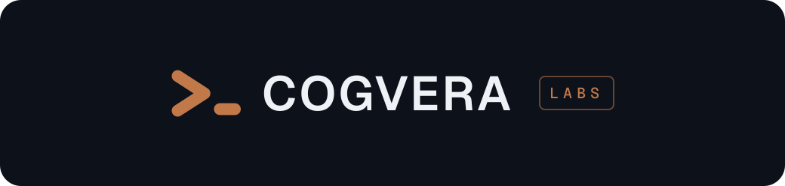

  

**Cogvera Labs** is an R&D lab in Perth for the hard problems standard AI tools leave unsolved. It builds open tools and runs open experiments on training AI models with hardware people own.

- [Akeratos](https://github.com/cogvera-labs/akeratos): language models trained from scratch on one Mac, with a large learned n-gram table and a twin trained without it.
- [The agent harness](https://github.com/cogvera-labs/next-expo-supabase-agent-harness): hooks that send an AI coding agent back to work when a check fails, and CI gates a project can require before any merge.

AI coding agents write most of the code here; Thomas Nicklin reviews and merges it.
